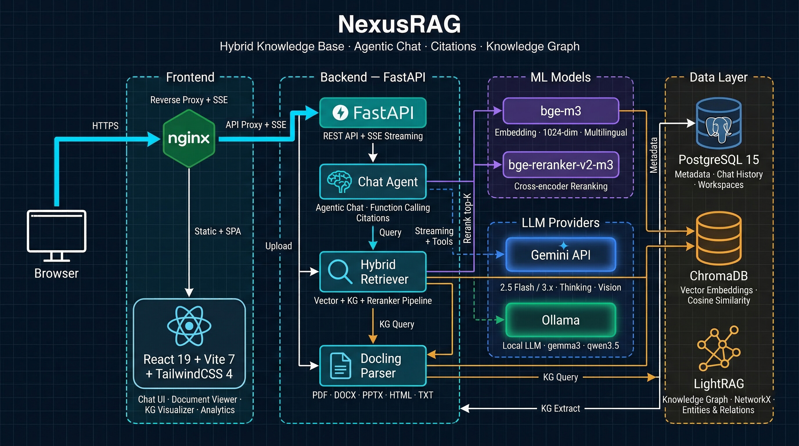
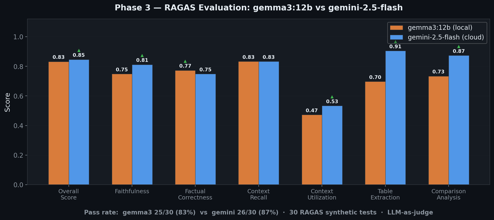
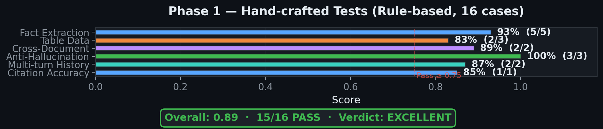

<div align="center">

# ⚡ Dual-Engine RAG

### *Next-Generation Enterprise Hybrid Retrieval-Augmented Generation Platform*

[](LICENSE)
[](https://www.python.org/)
[](https://fastapi.tiangolo.com/)
[](https://react.dev/)
[](https://www.typescriptlang.org/)
[](https://vitejs.dev/)
[](https://tailwindcss.com/)
[](https://www.docker.com/)
[](https://modelcontextprotocol.io/)

<p align="center">
  <b>A state-of-the-art document intelligence and conversational AI system combining Dense Vector Search, Entity-Relationship Knowledge Graphs, and Cross-Encoder Reranking for ultra-low hallucination, fully-traceable citations.</b>
</p>

---

### 👨‍💻 Created & Maintained by **Ranjith Sivasanmugam**

[](https://github.com/ranjiths112007)
[](https://www.linkedin.com/in/ranjith-sivashanmugam/)

</div>

---

## 📑 Table of Contents

- [Overview](#-overview)
- [Key Features](#-key-features)
- [System Architecture](#-system-architecture)
- [Evaluation & Benchmarks](#-evaluation--benchmarks)
- [Tech Stack](#-tech-stack)
- [Repository Structure](#-repository-structure)
- [Getting Started](#-getting-started)
  - [Prerequisites](#prerequisites)
  - [1. Clone Repository](#1-clone-repository)
  - [2. Configuration (.env)](#2-configuration-env)
  - [3. Automated Setup](#3-automated-setup)
- [Running Dual-Engine RAG](#-running-dual-engine-rag)
  - [Option A: One-Click Quick Launch (Windows)](#option-a-one-click-quick-launch-windows)
  - [Option B: Local Development Scripts](#option-b-local-development-scripts)
  - [Option C: Complete Docker Stack](#option-c-complete-docker-stack)
- [Model Context Protocol (MCP) Integration](#-model-context-protocol-mcp-integration)
- [REST API Reference](#-rest-api-reference)
- [Configuration Reference](#-configuration-reference)
- [Tips & Troubleshooting](#-tips--troubleshooting)
- [License](#-license)
- [Author & Acknowledgments](#-author--acknowledgments)

---

## 🌟 Overview

**Dual-Engine RAG** bridges the gap between semantic chunk retrieval and structured relational reasoning. Standard vector RAG systems often miss complex multi-hop dependencies or fail when dealing with structured tables, formulas, and diagrams. 

Dual-Engine RAG solves this with a multi-stage pipeline:
1. **Multimodal Document Parsing**: Extracts text chunks, markdown structure, tables, formulas (LaTeX), and images via IBM Docling / Marker.
2. **Dual-Index Architecture**: Concurrently populates a high-dimensional dense vector store (**ChromaDB** with `BAAI/bge-m3`) and an entity-relationship knowledge graph (**LightRAG**).
3. **Cross-Encoder Reranking**: Uses `BAAI/bge-reranker-v2-m3` to score and distill candidates, eliminating noisy context and maximizing context utilization.
4. **Agentic Streaming Synthesis**: Streams real-time tokens with timeline reasoning indicators and verifiable 4-character citation badges (`[c:xxxx]`) linked to source documents and page numbers.

---

## 🚀 Key Features

- 🔍 **Dual-Engine Retrieval**:
  - **Dense Semantic Retrieval**: Powered by `BAAI/bge-m3` (1024-dimensional embeddings) with hybrid dense-sparse scoring.
  - **Knowledge Graph Traversal**: Automatically extracts entities, relations, and communities via LightRAG for multi-hop synthesis.
- 🎯 **Cross-Encoder Reranking**:
  - Employs `BAAI/bge-reranker-v2-m3` to score the top-20 candidate pool down to the highest-confidence top-K chunks.
- 📄 **Deep Structural Ingestion**:
  - Choice of **IBM Docling** or **Marker** (Surya OCR / LaTeX) parsers.
  - Retains complex hierarchies, nested tables, mathematical equations, and diagrams.
  - Multimodal vision LLM captioning for embedded diagrams and charts.
- 💬 **Interactive Agentic Chat**:
  - Real-time Server-Sent Events (SSE) streaming.
  - Visual reasoning timeline (parsing, prefetch, reranking, synthesis).
  - Synchronized in-app PDF viewer with automatic jumping to cited page numbers.
- 🔌 **Standard Model Context Protocol (MCP) Server**:
  - Native MCP endpoint (`/mcp`) supporting cursor agents, Claude Desktop, and third-party AI orchestrators.
- 🌐 **Flexible LLM Backends**:
  - **Cloud**: Google Gemini 3.5 Flash / Flash Lite with extended reasoning depth.
  - **Offline/Local**: Ollama backends (Qwen 2.5/3.5, Gemma 3/4) with zero cloud dependencies.

---

## 🏗 System Architecture

```
                       +-----------------------------+
                       |    Raw Document Ingestion   |
                       |  (PDF, DOCX, PPTX, TXT, MD) |
                       +--------------+--------------+
                                      |
                     +----------------+----------------+
                     |                                 |
            [Docling / Marker]                [Docling / Marker]
           Structural & Text Chunks          Extracted Images & Tables
                     |                                 |
                     v                                 v
         +-----------+-----------+             +-------+-------+
         |                       |             | Vision LLM    |
         v                       v             | Captioning    |
 +---------------+       +---------------+     +-------+-------+
 |  Dense Vector |       |  Knowledge    |             |
 |  Embedding    |       |  Graph Extr.  |             v
 | (bge-m3 1024d)|       | (LightRAG)    |     +---------------+
 +-------+-------+       +-------+-------+     | Multi-modal   |
         |                       |             | Vector Search |
         v                       v             +-------+-------+
   [ChromaDB Store]       [PostgreSQL KG]              |
         \                       /                    /
          \                     /                    /
           +---------+---------+--------------------+
                     |
                     v
        +----------------------------+
        |   3-Way Parallel Candidate |
        |   Prefetch (Top 20 Chunks) |
        +-------------+--------------+
                      |
                      v
        +----------------------------+
        |   Cross-Encoder Reranker   |
        |  (bge-reranker-v2-m3)      |
        +-------------+--------------+
                      |
                      v
        +----------------------------+
        | Top-K Filtered Context     |
        | + Structured Citation Tags |
        +-------------+--------------+
                      |
                      v
        +----------------------------+
        | Agentic LLM Synthesis      |
        | (Gemini / Local Ollama)    |
        +-------------+--------------+
                      |
                      v
          Real-Time SSE Response
        with Page-Level Citations
```

<div align="center">
  
</div>

---

## 📊 Evaluation & Benchmarks

Dual-Engine RAG has been rigorously benchmarked using both rule-based test suites and **Ragas LLM-as-a-judge** methodologies on bilingual multi-document corpora:

<div align="center">
  
  
</div>

### Benchmark Results Summary

| Metric | Local (gemma3:12b) | Cloud (gemini-2.5/3.5-flash) | Benchmark Status |
|---|---|---|---|
| **Anti-Hallucination Rate** | **100.0%** | **100.0%** | Out-of-scope queries refused cleanly |
| **Citation Precision** | **100.0%** | **100.0%** | Validated badge & page mapping |
| **Pass Rate (Rule-based)** | 93.8% (15/16) | 93.8% (15/16) | Excellent factual extraction |
| **Ragas Overall Score** | 0.832 | **0.846** | High confidence |
| **Faithfulness** | 0.749 | **0.812** | Grounded in retrieved evidence |
| **Context Recall** | **0.833** | **0.833** | Cross-document coverage |
| **Table Extraction Accuracy** | 0.697 | **0.905** | Complex multi-row tabular parsing |
| **Average Query Latency** | **3.07 s** | 3.28 s | Real-time streaming response |

*Full details and logs available in [`showcase/rag_evaluation_report.md`](showcase/rag_evaluation_report.md).*

---

## 💻 Tech Stack

| Layer | Technologies |
|---|---|
| **Frontend** | React 19, TypeScript, Vite, Tailwind CSS v4, Lucide Icons, KaTeX, Zustand, TanStack Query |
| **Backend** | Python 3.10+, FastAPI, Pydantic v2, SQLAlchemy (asyncpg), Uvicorn |
| **Vector DB** | ChromaDB (1024-dim dense vectors) |
| **Graph DB & Relational** | PostgreSQL 15, LightRAG entity/relation index |
| **Ingestion Engine** | IBM Docling, Marker (Surya OCR, LaTeX math recognition) |
| **Models & Reranker** | `BAAI/bge-m3`, `BAAI/bge-reranker-v2-m3`, Google Gemini 3.5 Flash, Ollama |
| **Protocol** | Model Context Protocol (MCP) Streamable HTTP Server |
| **Deployment** | Docker, Docker Compose, Nginx Reverse Proxy |

---

## 📂 Repository Structure

```
Dual-Engine-RAG/
├── backend/
│   ├── alembic/                 # Database migrations (Alembic)
│   ├── app/
│   │   ├── api/                 # FastAPI routes (workspaces, documents, rag, chat)
│   │   ├── core/                # Configuration, database connection, dependencies
│   │   ├── models/              # SQLAlchemy models
│   │   ├── schemas/             # Pydantic validation schemas
│   │   └── services/            # Dual-Engine services (parser, KG, retriever, reranker)
│   ├── scripts/                 # Evaluation & model download utilities
│   └── requirements.txt         # Backend Python dependencies
├── frontend/
│   ├── src/
│   │   ├── components/          # React components (ChatPanel, VisualPanel, Sidebar)
│   │   ├── hooks/               # Custom hooks (SSE streaming, workspace queries)
│   │   ├── stores/              # Zustand global state management
│   │   └── types/               # TypeScript type definitions
│   ├── package.json             # Frontend dependencies
│   └── vite.config.ts           # Vite build configuration
├── mcp-server/                  # Model Context Protocol service (Node/TypeScript)
├── showcase/                    # Architecture diagrams, benchmark charts & reports
├── docker-compose.yml           # Full application multi-container compose
├── docker-compose.services.yml  # Standalone data services (PostgreSQL + ChromaDB)
├── Dockerfile.backend           # Production FastAPI container
├── Dockerfile.frontend          # Production Nginx + React container
├── run_bk.ps1 / run_bk.sh       # Backend start script (Windows / Linux)
├── run_fe.ps1 / run_fe.sh       # Frontend start script (Windows / Linux)
├── setup.ps1 / setup.sh         # Complete automated setup script
├── start_all.bat                # One-click Windows launch script
├── LICENSE                      # Open-source MIT License
├── .env.example                 # Template environment variables
└── README.md                    # Project documentation
```

---

## ⚡ Getting Started

### Prerequisites

- **Python**: 3.10 or higher
- **Node.js**: 18.0.0 or higher
- **pnpm**: 8.0.0 or higher (`npm install -g pnpm`)
- **Docker**: (Optional) For running PostgreSQL and ChromaDB containers

---

### 1. Clone Repository

```bash
git clone https://github.com/ranjiths112007/Dual-Engine-RAG.git
cd Dual-Engine-RAG
```

---

### 2. Configuration (.env)

Copy the sample environment file:

```bash
# Windows (PowerShell)
Copy-Item .env.example .env

# Linux / macOS
cp .env.example .env
```

Open `.env` and configure your API key (if using Gemini):

```env
GOOGLE_AI_API_KEY=your_gemini_api_key_here
```

*(If running completely offline with Ollama, set `LLM_PROVIDER=ollama` and `KG_EMBEDDING_PROVIDER=sentence_transformers`.)*

---

### 3. Automated Setup

Run the automated installer which validates tools, creates a Python virtual environment, installs backend and frontend dependencies, and checks services:

#### On Windows (PowerShell):
```powershell
.\setup.ps1
```

#### On Linux / macOS (Bash):
```bash
chmod +x setup.sh run_bk.sh run_fe.sh
./setup.sh
```

---

## 🚀 Running Dual-Engine RAG

### Option A: One-Click Quick Launch (Windows)

If you are on Windows, simply run:

```cmd
start_all.bat
```

This automatically spins up PostgreSQL via Docker, ChromaDB on port 8002, the FastAPI backend on port 8080, and the Vite frontend on port 5174 in synchronized windows!

---

### Option B: Local Development Scripts

1. **Start Datastores (PostgreSQL & ChromaDB)**:
   ```bash
   docker compose -f docker-compose.services.yml up -d
   ```

2. **Start Backend Server**:
   - **Windows**:
     ```powershell
     .\run_bk.ps1
     ```
   - **Linux / macOS**:
     ```bash
     ./run_bk.sh
     ```

3. **Start Frontend Client**:
   - **Windows**:
     ```powershell
     .\run_fe.ps1
     ```
   - **Linux / macOS**:
     ```bash
     ./run_fe.sh
     ```

4. **Access the Application**:
   - 🖥️ **Web Application**: [http://localhost:5174](http://localhost:5174)
   - 📖 **Interactive Swagger API Docs**: [http://localhost:8080/docs](http://localhost:8080/docs)

---

### Option C: Complete Docker Stack

Deploy the entire stack (FastAPI, React UI, Nginx, PostgreSQL, ChromaDB, MCP Server) in one command:

```bash
docker compose up -d --build
```

---

## 🤖 Model Context Protocol (MCP) Integration

Dual-Engine RAG provides an MCP-compliant server running on port `8000` via Streamable HTTP. This enables cursor agents, Claude Desktop, and autonomous tools to query your indexed knowledge base directly.

### Tools Exposed by MCP:
- `get_workspace_list`: Lists all workspaces and knowledge base metadata.
- `get_document_by_id`: Fetches parsed markdown content and structural chunks.
- `query`: Executes hybrid vector + knowledge graph queries.

### Integration in Claude Desktop / Cursor:
Add the following to your MCP client configuration (`claude_desktop_config.json`):

```json
{
  "mcpServers": {
    "dual-engine-rag": {
      "command": "node",
      "args": ["d:/Dual-Engine RAG/Dual-Engine-RAG/mcp-server/dist/index.js"],
      "env": {
        "BACKEND_API_URL": "http://localhost:8080/api/v1"
      }
    }
  }
}
```

Or connect directly via the streamable HTTP URL:
```
http://localhost:8000/mcp
```

---

## 🔌 REST API Reference

The backend provides a complete RESTful API documented interactively with Swagger at `/docs`.

### Workspaces
- `GET /api/v1/workspaces` — List all active knowledge base workspaces.
- `POST /api/v1/workspaces` — Create a workspace with custom system prompt and parameters.
- `PUT /api/v1/workspaces/{id}` — Update workspace settings.
- `DELETE /api/v1/workspaces/{id}` — Delete workspace and purge vector/graph indices.

### Documents
- `POST /api/v1/documents/upload/{workspace_id}` — Upload document (`PDF`, `DOCX`, `PPTX`, `TXT`, `MD`).
- `GET /api/v1/documents/{id}/markdown` — Retrieve structured parsed markdown.
- `GET /api/v1/documents/{id}/images` — List extracted tables and diagrams.
- `DELETE /api/v1/documents/{id}` — Delete document and clean corresponding chunks.

### RAG & Streaming Chat
- `POST /api/v1/rag/process/{document_id}` — Trigger background parsing and knowledge graph extraction.
- `POST /api/v1/rag/query/{workspace_id}` — Execute hybrid retrieval query.
- `POST /api/v1/rag/chat/{workspace_id}/stream` — Server-Sent Events (SSE) streaming chat with reasoning steps.
- `GET /api/v1/rag/graph/{workspace_id}` — Fetch knowledge graph nodes and relationships for visual explorer.
- `GET /api/v1/rag/stats/{workspace_id}` — Retrieve indexing statistics and chunk metrics.

---

## ⚙️ Configuration Reference

Key configuration options supported in `.env`:

| Setting | Default | Description |
|---|---|---|
| `DATABASE_URL` | `postgresql+asyncpg://...` | PostgreSQL async connection string |
| `CHROMA_HOST` | `localhost` | ChromaDB host |
| `CHROMA_PORT` | `8002` | ChromaDB port |
| `LLM_PROVIDER` | `gemini` | Primary inference provider: `gemini` or `ollama` |
| `GOOGLE_AI_API_KEY` | `""` | Google AI Studio API key |
| `LLM_MODEL_FAST` | `gemini-3.5-flash` | LLM model ID for synthesis and graph extraction |
| `LLM_THINKING_LEVEL` | `medium` | Extended reasoning depth (`minimal`, `low`, `medium`, `high`) |
| `KG_EMBEDDING_PROVIDER`| `gemini` | Graph embedding provider: `gemini`, `ollama`, `sentence_transformers` |
| `KG_EMBEDDING_MODEL` | `gemini-embedding-001` | Model name for graph entity embeddings |
| `KG_EMBEDDING_DIMENSION`| `3072` | Graph embedding vector dimensions |
| `DUAL_ENGINE_RAG_ENABLED` | `true` | Enable hybrid vector + graph pipeline |
| `DUAL_ENGINE_RAG_DOCUMENT_PARSER` | `docling` | Parser engine: `docling` or `marker` |
| `DUAL_ENGINE_RAG_EMBEDDING_MODEL` | `BAAI/bge-m3` | Dense vector embedding model (1024-dim) |
| `DUAL_ENGINE_RAG_RERANKER_MODEL` | `BAAI/bge-reranker-v2-m3` | Cross-encoder reranker model |
| `DUAL_ENGINE_RAG_VECTOR_PREFETCH` | `20` | Number of candidate chunks pre-fetched before reranking |
| `DUAL_ENGINE_RAG_RERANKER_TOP_K` | `8` | Final top-K chunks passed to LLM context |
| `DUAL_ENGINE_RAG_ENABLE_IMAGE_EXTRACTION` | `true` | Extract figures and diagrams during ingestion |
| `DUAL_ENGINE_RAG_ENABLE_IMAGE_CAPTIONING` | `true` | Generate vision-LLM captions for extracted figures |

---

## 💡 Tips & Troubleshooting

- **Managing Disk Space on Windows (C: Drive Cache)**:
  Deep learning models (`bge-m3`, `bge-reranker`, Docling OCR) can take substantial disk space. You can redirect Hugging Face, PyTorch, and temporary cache directories to another drive (e.g. `D:`) by setting:
  ```powershell
  $env:HF_HOME = "D:\ai_cache\hf"
  $env:TORCH_HOME = "D:\ai_cache\torch"
  $env:DOCLING_CACHE_DIR = "D:\ai_cache\docling"
  $env:TEMP = "D:\ai_cache\temp"
  ```
  *The included `run_bk.ps1` script automatically configures cache redirection.*

- **Running 100% Offline (Local Models)**:
  Set `LLM_PROVIDER=ollama` and `KG_EMBEDDING_PROVIDER=sentence_transformers`. The system will run locally using Ollama (`qwen2.5` or `gemma3`) and local embeddings without sending any data to external APIs.

- **PostgreSQL Container Architecture Compatibility**:
  If encountering architecture or format errors with Docker Alpine containers on Windows WSL2, the provided `docker-compose.services.yml` uses Debian-based `postgres:15` for maximum stability across platforms.

---

## 📄 License

This project is licensed under the **MIT License** — you are free to use, modify, distribute, and integrate this software into commercial or private projects. See the [LICENSE](LICENSE) file for details.

---

## 👤 Author & Acknowledgments

**Dual-Engine RAG** is built and maintained with ❤️ by **Ranjith Sivasanmugam**.

- **LinkedIn**: [https://www.linkedin.com/in/ranjith-sivashanmugam/](https://www.linkedin.com/in/ranjith-sivashanmugam/)
- **GitHub**: [@ranjiths112007](https://github.com/ranjiths112007)

*If you find this project useful, feel free to star ⭐ the repository and connect on LinkedIn!*
